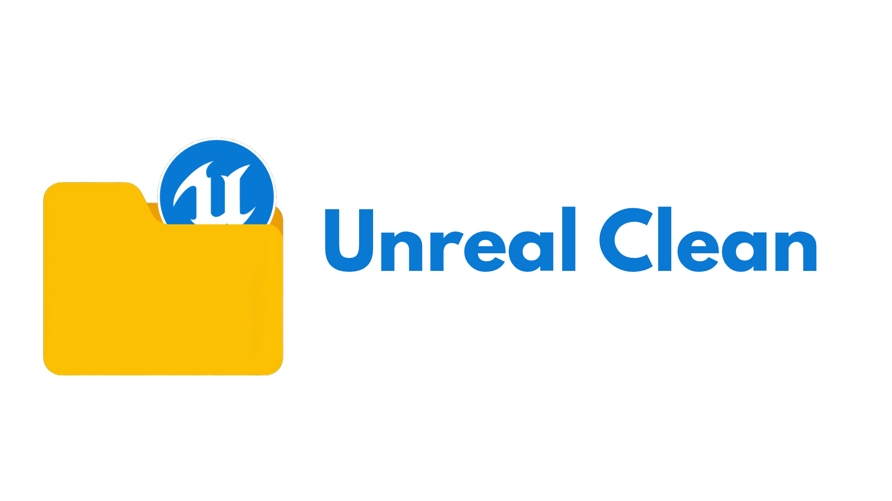

# Unreal Clean : 

<picture>
  <source
    srcset="https://github.com/RyanEllisDale/Unreal-Clean/blob/main/Assets/Unreal%20Clean%20Dark%20Mode%20Page%20Front.png"
    media="(prefers-color-scheme: dark)"
  />
  <source
    srcset="https://github.com/RyanEllisDale/Unreal-Clean/blob/main/Assets/Unreal%20Clean%20Bright%20Mode%20Page%20Front.png"
    media="(prefers-color-scheme: light), (prefers-color-scheme: no-preference)"
  />
  
</picture>
    
> [!WARNING]
> This program will delete files on your machine and thus windows will flag it as a potential virus. I'm currently trying to resolve this issue by getting the application certified through the Microsoft Store to prove it serves no harm.

Unreal Clean is a simple executable script that will clean out the generated visual studio files that unreal engine creates. Useful for when you want to rebuild your project, regenerate the files from a clean slate or upload your project to version control. I got quite tired of manually selecting and deleting the relevant Unreal Engine generated Visual Studio files every-time I wanted to rebuild / re-generate the program and thus have created this small script to do it for anyone interested.

Unreal Engine will delete the following folders and files :
- .vs/
- Binaries/
- Intermediate/
- Saved/
- .sln
- .slnx
- .vsconfig

Please note any issues you find on the issues page in the github, thank you !
 
The current released (Version 1.0.1) can be found at : https://github.com/RyanEllisDale/Unreal-Clean/releases/tag/v1.0.1 
